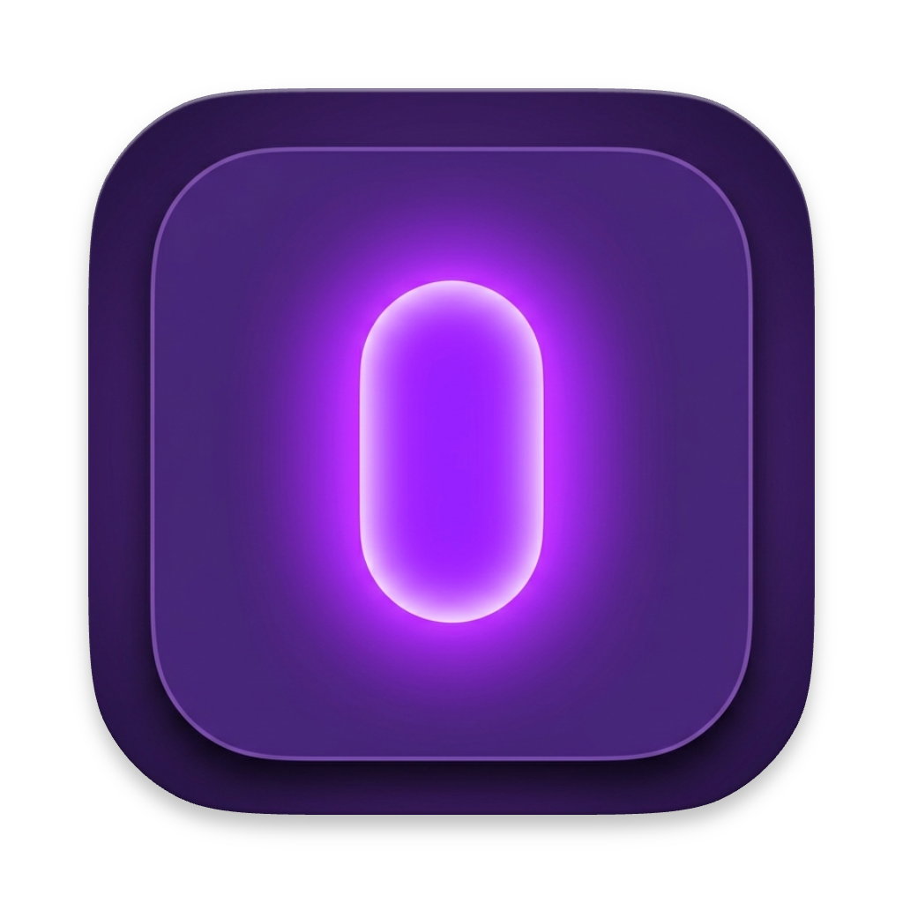
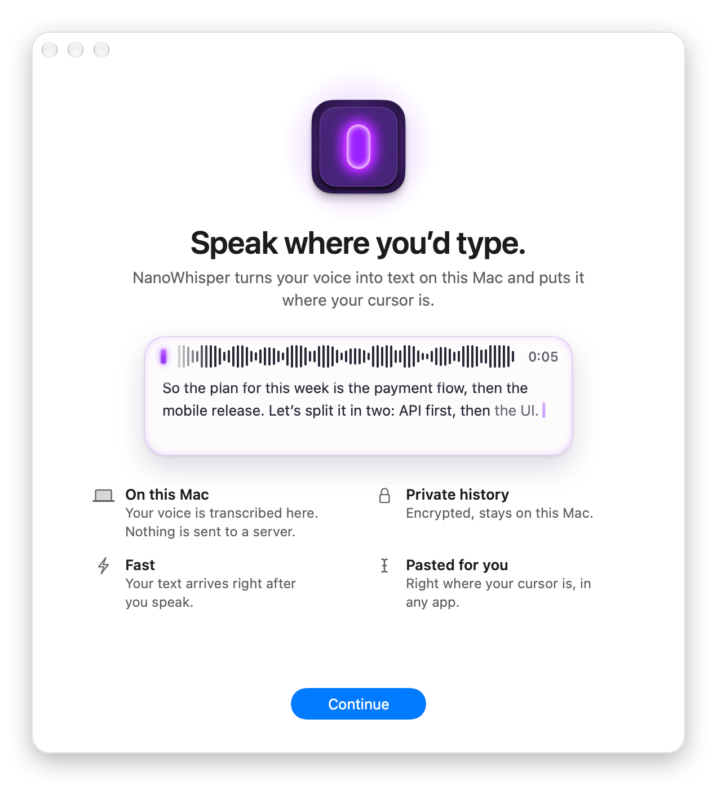
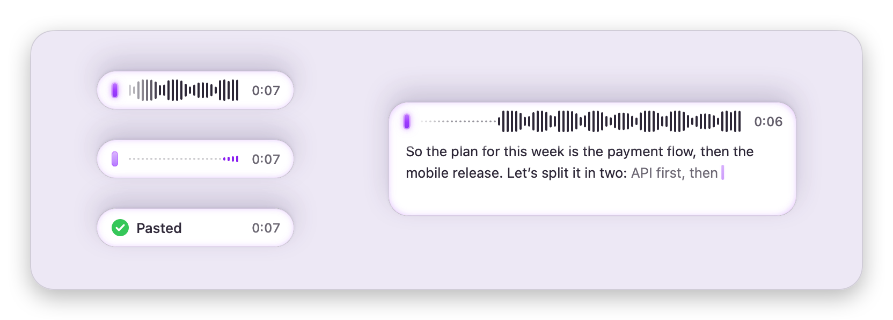
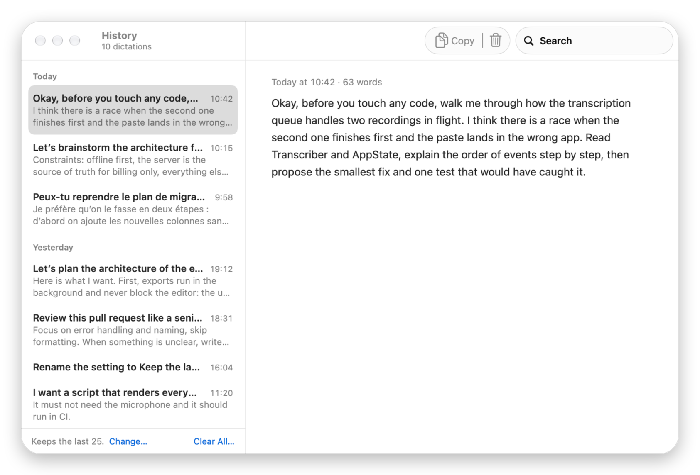
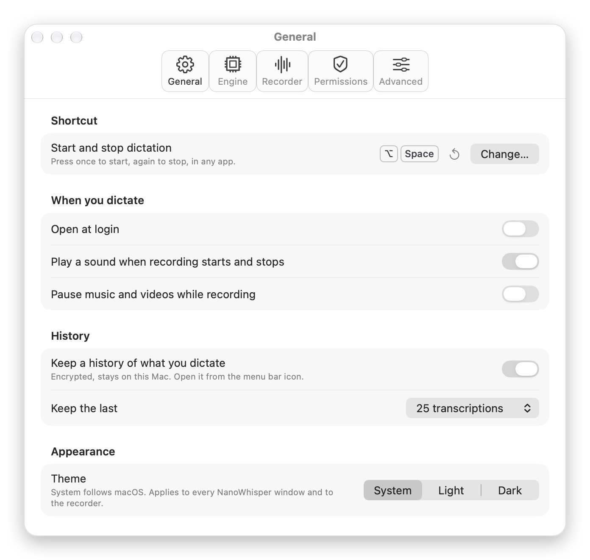
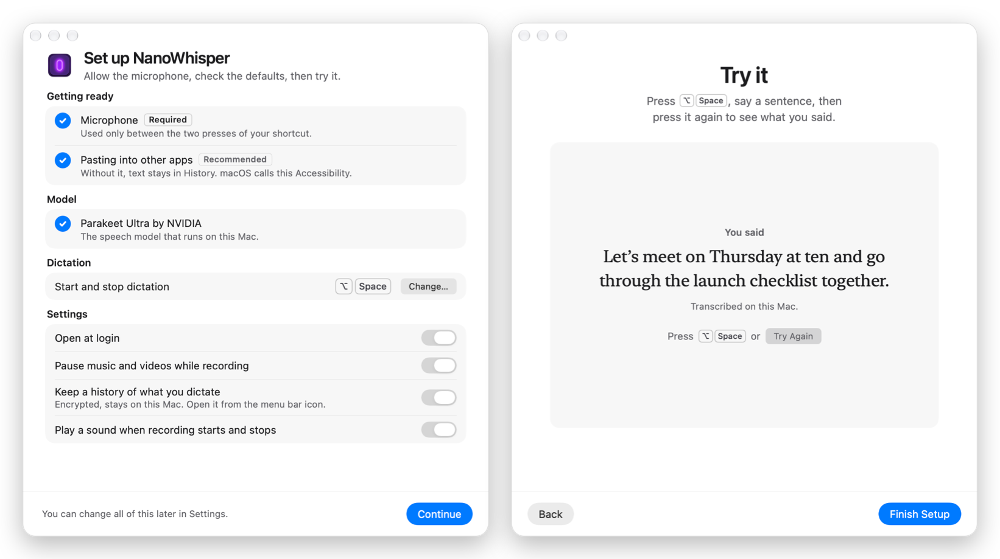
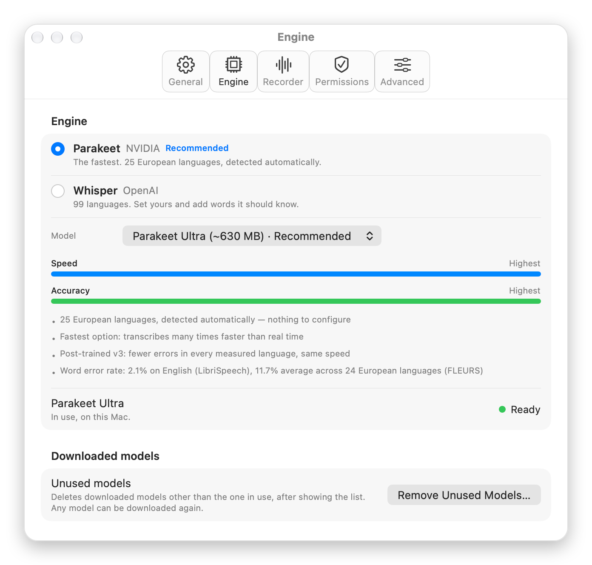

<p align="center">
  
</p>

<h1 align="center">NanoWhisper</h1>

<p align="center">
  <strong>Speak where you’d type.</strong>
</p>

<p align="center">
  Press a shortcut, talk, press it again. NanoWhisper transcribes your voice on your Mac<br>
  and pastes the text where your cursor is, in any app. No account, no server, no subscription.
</p>

<p align="center">
  <a href="https://github.com/Xavierdesousa/NanoWhisper/releases/latest"></a>
</p>

<p align="center">
  <a href="https://github.com/Xavierdesousa/NanoWhisper/releases/latest"></a>
  
  
  <a href="LICENSE"></a>
  <a href="https://github.com/Xavierdesousa/NanoWhisper/actions/workflows/ci.yml"></a>
</p>

<p align="center">
  <picture>
    <source media="(prefers-color-scheme: dark)" srcset="docs/images/hero-dark.png">
    
  </picture>
</p>

## Think out loud. The text is already there.

Typing is the slow part when you are thinking: explaining a plan to an AI agent, brainstorming,
reviewing a design, writing feedback. NanoWhisper is built for those long spoken thoughts. Talk
for one minute or ten; when you stop, the text is in your editor, terminal or chat, a moment later.
Five minutes of speech is transcribed in under a second.¹

<table>
  <tr>
    <td align="center" width="33%"><h3>0.19 s</h3>median transcription time<br><sub>18 of 25 dictations under a quarter of a second</sub></td>
    <td align="center" width="33%"><h3>126×</h3>faster than real time, typically<br><sub>median of 25 dictations; up to 327×</sub></td>
    <td align="center" width="33%"><h3>1.8 s</h3>for 9½ minutes of speech<br><sub>one dictation of 960 words</sub></td>
  </tr>
</table>

<sub>¹ Measured on 21 November 2026 on a MacBook Pro with M3 Pro (18 GB), macOS 27.2, with Parakeet Ultra
and the 0.1.0 code, on the maintainer’s own dictations: 25 dictations (23.7 minutes of mostly French
speech), plus one dictation of 9 min 31 s. Five minutes is interpolated from 4 min 30 s in 0.82 s
and 9 min 31 s in 1.78 s. Times are the model’s transcription time only: they leave out the 0.3 s
NanoWhisper keeps listening after you press stop, and the paste. Other Macs will differ.
[Details](docs/wiki/transcription-engines.md#measured-speed-on-real-dictations-2026-11-21).</sub>

## How it works

1. **Press <kbd>⌥</kbd> <kbd>Space</kbd>** in any app. The recorder appears at the top of the screen and shows your voice.
2. **Speak**, as long as you need. There is no time limit.
3. **Press <kbd>⌥</kbd> <kbd>Space</kbd> again.** The text is pasted where your cursor is, and kept in your History.

Transcription runs on your Mac with Core ML, using NVIDIA’s
[Parakeet](https://huggingface.co/nvidia/parakeet-tdt-0.6b-v3) (through
[FluidAudio](https://github.com/FluidInference/FluidAudio)) or OpenAI’s Whisper (through
[WhisperKit](https://github.com/argmaxinc/argmax-oss-swift)). Your voice never leaves the Mac.

## Features

### Dictation, in every app

- **One shortcut.** <kbd>⌥</kbd> <kbd>Space</kbd> by default; choose your own in Settings. It works in any
  app you can paste into: editors, terminals, browsers, chats, AI agents.
- **Your last word counts.** NanoWhisper keeps listening for 0.3 s after you press stop, so the word you
  were finishing is not cut off.
- **Keep going.** Start the next dictation while the previous one is still being transcribed; each
  one is delivered, in order.
- **Nothing lost.** If NanoWhisper stops unexpectedly during a recording, that recording is transcribed
  at the next launch and appears in History (when History is on, within 7 days).

### The recorder

<picture>
  <source media="(prefers-color-scheme: dark)" srcset="docs/images/recorder-dark.png">
  
</picture>

- A small capsule with a live waveform of your voice and a timer. Point at it to stop with the mouse.
  When you stop, a light sweeps across it while it transcribes, then it says “Pasted” (or “No speech
  detected”).
- Dark or light, following your theme.
- At the top left, top center, top right or bottom center of the screen with the pointer. Drag it
  aside for one recording.

### Live transcription (beta)

Off by default. Turn on **Settings › Recorder › Show words in the recorder as you speak** and the
recorder grows into a card that shows your words while you talk (on the right in the picture
above). Words can change while you speak. When you stop, the whole recording is transcribed again,
so the text pasted is exactly what you would get with live transcription off. Available with
Parakeet and with Whisper Base.

### History

<picture>
  <source media="(prefers-color-scheme: dark)" srcset="docs/images/history-dark.png">
  
</picture>

- Every dictation in one window: a list by day and the full text, with search (ignoring case and
  accents), copy, and delete with <kbd>⌘</kbd> <kbd>Z</kbd> to bring it back.
- Encrypted, and it stays on your Mac. Keeps the last 25 dictations by default (from 5 to 100).
- Turn History off and nothing is kept: what it held is deleted.
- Open it from the menu bar icon.

### Comfort

<picture>
  <source media="(prefers-color-scheme: dark)" srcset="docs/images/settings-general-dark.png">
  
</picture>

- **Pauses music and videos** while you dictate and resumes them afterwards (what Control Center shows
  as Now Playing, browser tabs included).
- **Sounds** when recording starts and stops; they can be turned off.
- **Opens at login** if you want it to, and lives in the menu bar: no Dock icon.
- **Theme:** System, Light or Dark, for every window and the recorder.
- **Updates:** NanoWhisper checks GitHub for a new release every hour. One click in the menu
  installs it and relaunches; your settings, history and models stay.
- **Models that move forward.** When a better model becomes the recommended one, NanoWhisper
  downloads it in the background while you keep dictating with the current one, then switches.

## Privacy and security

- **Transcription never leaves your Mac.** The network is used for two things only: downloading
  speech models (from Hugging Face, once per model) and checking GitHub for updates (and downloading
  one when you choose to install it). There is no account and no analytics. With Parakeet, dictation
  works offline once the model is downloaded.
- **The microphone is used only between the two presses** of your shortcut.
- **Recordings are not kept.** Each recording is a temporary file, overwritten with zeros and deleted
  once it is transcribed.
- **History is encrypted** with AES-256-GCM, with a key derived from this Mac’s hardware UUID
  (HKDF-SHA256). A copy of the file, a backup, or the file on another Mac cannot be read. It does not
  protect against other software running under your user account, which can read the same hardware
  UUID. If you want nothing kept, turn History off.
- **Open source** under the GPL v3: you can read and build every line.

NanoWhisper asks for two permissions:

| Permission | | Why |
|---|---|---|
| **Microphone** | Required | To record between the two presses of your shortcut. |
| **Accessibility** (“Pasting into other apps”) | Recommended | To paste the text by sending <kbd>⌘</kbd> <kbd>V</kbd> to the app in front. Without it nothing is pasted; the text stays in History if History is on. |

## Install

1. Download `NanoWhisper-v<version>.zip` from the [**latest release**](https://github.com/Xavierdesousa/NanoWhisper/releases/latest).
2. Unzip it and move `NanoWhisper.app` to your Applications folder.
3. Open it.

> [!NOTE]
> **First launch: allow it once.** NanoWhisper is signed, but not notarized by Apple yet
> (notarization is planned), so macOS blocks the first launch. To allow it
> ([Apple’s instructions](https://support.apple.com/guide/mac-help/open-a-mac-app-from-an-unknown-developer-mh40616/mac)):
>
> 1. Open `NanoWhisper.app`. macOS shows a warning; close it (do not move the app to the Trash).
> 2. Open **System Settings › Privacy & Security** and scroll to **Security**. Next to the message about
>    NanoWhisper, click **Open Anyway** (shown for about an hour after the attempt), then enter your login password.
> 3. Open NanoWhisper again. From then on it opens normally.
>
> Or, in Terminal: `xattr -dr com.apple.quarantine /Applications/NanoWhisper.app`. Both allow this
> app only; Gatekeeper’s settings are not changed.

### First launch

<picture>
  <source media="(prefers-color-scheme: dark)" srcset="docs/images/onboarding-dark.png">
  
</picture>

One window walks you through it: a short welcome, then a setup page where you allow the
microphone and pasting while the speech model downloads (Parakeet Ultra, about 630 MB), check the
shortcut and four settings, then **Try it**: one test dictation, shown in the window, never pasted
or saved. After that, NanoWhisper lives in the menu bar.

## Usage

| To | Do this |
|---|---|
| Dictate | Press <kbd>⌥</kbd> <kbd>Space</kbd>, speak, press it again. Or **Start Dictation** in the menu. |
| Stop with the mouse | Point at the recorder and click Stop. |
| Find an earlier dictation | Menu bar icon › **History…**, then search; <kbd>⌘</kbd> <kbd>C</kbd> copies it. |
| Change anything | Menu bar icon › **Settings…** (<kbd>⌘</kbd> <kbd>,</kbd>) |

Settings has five panes: **General** (shortcut, open at login, sounds, pausing media, history,
theme), **Engine** (speech model, its download, Whisper language and vocabulary, removing unused
models), **Recorder** (position, live transcription), **Permissions**, **Advanced** (updates,
debug info in History).

## Models

<picture>
  <source media="(prefers-color-scheme: dark)" srcset="docs/images/settings-engine-dark.png">
  
</picture>

| Engine | Model | Download | Notes |
|---|---|---|---|
| **Parakeet** (NVIDIA), via FluidAudio | **Parakeet Ultra** · Recommended, the default | ~630 MB | 25 European languages, detected automatically. A post-trained v3 ([moondream/parakeet-ultra](https://huggingface.co/moondream/parakeet-ultra)): fewer errors, same speed. |
| | Parakeet TDT 0.6B v3 | ~480 MB | NVIDIA’s original model. |
| **Whisper** (OpenAI), via WhisperKit | Base | ~150 MB | 99 languages. Small and fast, noticeably less accurate. |
| | Small | ~490 MB | Balanced size, speed and accuracy. |
| | **Large v3 Turbo** · Recommended for Whisper | ~630 MB | Accuracy close to Large v3. Slow to load: 82–93 s at each launch in our tests. |

Word error rates published by FluidAudio
([benchmarks](https://github.com/FluidInference/FluidAudio/blob/main/Documentation/ASR/ParakeetUltra.md)):
LibriSpeech test-clean 2.27 % (v3) → 2.13 % (Ultra); FLEURS, mean of 24 languages, 14.81 % → 11.67 %.

With Whisper you can set the spoken language (more reliable on short clips) and give a
**vocabulary hint**: names and technical terms it should expect.

**Updates move you to the best model, without a gap.** Updating from 0.0.5 or earlier on
Parakeet v3, NanoWhisper moves you to Parakeet Ultra once: you keep dictating with v3 while Ultra
downloads, and it switches when Ultra is ready (offline, it tries again at the next launch). v3
stays available in Settings. Whisper Tiny, Medium and Large v3 are no longer offered: a saved Tiny
becomes Base, a saved Medium or Large v3 becomes Large v3 Turbo, and the old model keeps working
until the new one is ready.

**Disk space.** Models NanoWhisper no longer offers are deleted once their replacement is loaded.
Models you can still choose are never deleted on their own: **Settings › Engine › Remove Unused
Models…** lists them with their sizes and deletes them after you confirm. NanoWhisper only ever
touches the folders it downloaded itself.

## Requirements

- macOS 14 Sonoma or later
- A Mac with Apple Silicon
- About 1 GB of free disk space (Parakeet Ultra takes about 630 MB)
- An internet connection for the first model download

## Roadmap

Planned, not built yet:

- **0.1.1:** two release channels, **Stable** (the default) and **Beta** (opt-in, earlier features),
  and updates that install on their own while NanoWhisper is idle, with a setting to turn that off.
- **Notarization** with an Apple Developer ID, so the first launch needs no extra step.
- **Onboarding in French.**
- **Homebrew** installation.

## Build from source

Requires Xcode with Swift 6.2 or later (releases are built with Xcode 27.1 and the macOS 27 SDK).
The package uses SwiftPM traits to build FluidAudio without its TTS and diarization modules.

```bash
git clone https://github.com/Xavierdesousa/NanoWhisper.git
cd NanoWhisper
make app
```

`make app` builds, signs and launches **NanoWhisper Debug**, a separate app that can run next to
the released NanoWhisper:

| | NanoWhisper (release) | NanoWhisper Debug (local builds) |
|---|---|---|
| Bundle | `NanoWhisper.app`, `com.moonji.nanowhisper` | `NanoWhisper Debug.app`, `com.moonji.nanowhisper.debug` |
| Default shortcut | ⌥ Space | ⌃⌥ Space |
| Settings, permissions, login item | own | own (granted separately) |
| History | `~/Library/Application Support/NanoWhisper` | `~/Library/Application Support/NanoWhisper Debug` |
| Auto-updater | on | off |
| Markers | — | “DEBUG” banner on the icon, orange band across the menu bar icon, version and commit in the menu |

Downloaded models are shared by both. `make app` only stops a running NanoWhisper Debug, never the
release app.

| Target | Builds | Notes |
|---|---|---|
| `make app` | Debug | Launches it |
| `make onboarding` | Debug | Launches it with `--onboarding` (shows onboarding again; settings and models are kept) |
| `make handoff` | Debug | Launches it with `--show-handoff` (the end-of-onboarding popover) |
| `make run` | Debug | Runs the executable without a bundle |
| `make ci` | Release | `NanoWhisper.app`, no launch (used by the release workflow) |
| `make release` | Release | Also creates `NanoWhisper-v<version>.zip`; launches nothing |
| `make notarize` | Release | Notarizes and staples (`NOTARY_PROFILE=<keychain profile>`) |
| `make publish` | Release | Creates the GitHub release for tag `v<version>` with `gh` (fallback when CI can’t run); needs a clean tree and the tag pushed to `origin` at HEAD |
| `make test`, `make clean` | | |

Signing uses `SIGN_IDENTITY` (default `Moonji Dev`; set it empty for ad-hoc signing).

## Contributing

Bug reports and ideas are welcome in [Issues](https://github.com/Xavierdesousa/NanoWhisper/issues).
To work on the code, with or without a coding agent, start with [`CLAUDE.md`](CLAUDE.md) (commands,
rules, source map) and the project wiki in [`docs/wiki/index.md`](docs/wiki/index.md) (design
decisions, measurements, what is not tested yet).

## Acknowledgements

NanoWhisper stands on [FluidAudio](https://github.com/FluidInference/FluidAudio) and
[WhisperKit](https://github.com/argmaxinc/argmax-oss-swift), which run NVIDIA’s
[Parakeet](https://huggingface.co/nvidia/parakeet-tdt-0.6b-v3) (and
[Parakeet Ultra](https://huggingface.co/moondream/parakeet-ultra), a post-trained version of it)
and OpenAI’s Whisper on Core ML.

## License

[GPL v3](LICENSE): free to use, modify and redistribute. Forks must stay open source under the
same license.
